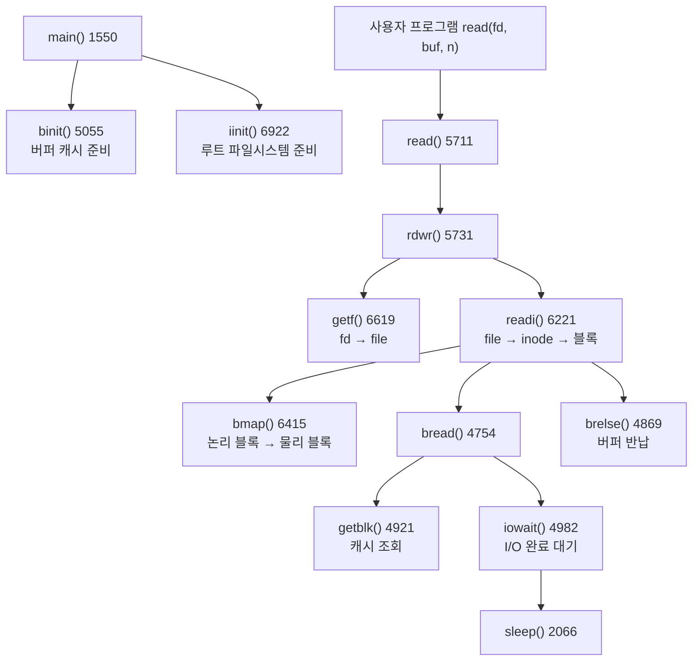
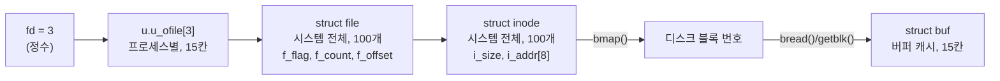

# UNIX V6 커널 코드 분석 — read() 한 번이 디스크까지 가는 길

- 과목: 운영체제
- 이름: 고은우
- 학번: 20220814
- 분석 대상: UNIX Version 6 (Lions' Commentary 소스, https://warsus.github.io/lions-/)
- 분석 범위: main() → binit() / iinit(), read() → rdwr() → getf() → readi() → bread() → getblk() / iowait() / brelse()
  - Lions' Commentary Section Three 17장(Buffer Manipulation), Section Four 18장(File Access and Control), 20장(File Systems), Section One 6장(main())
- 코드 앞의 4자리 숫자는 Lions 소스의 행 번호다.

---

## 1. 개요

### 1.1 왜 이 주제를 골랐나

백엔드 서버도 결국 파일과 소켓을 읽고 쓰는 프로그램이다. Too many open files 에러, write는 성공했는데 장애 후 데이터가 없는 문제, I/O 대기 중인 프로세스가 kill로도 죽지 않는 현상은 모두 커널의 파일 I/O 경로에서 나온다. 현대 리눅스 커널은 너무 커서 이 경로를 처음부터 끝까지 따라가기 어렵지만, UNIX V6는 같은 구조를 수백 줄 안에 담고 있다.

본 보고서에서는 사용자 프로그램이 read(fd, buf, n)을 한 번 호출했을 때 커널 안에서 무슨 일이 일어나는지를 fd → 열린 파일 → inode → 디스크 블록 → 버퍼 캐시 순서로 따라가기로 했다. 출발점은 과제 기준에 맞춰 main()으로 잡았다. main()이 부팅 중에 binit()과 iinit()을 호출해 버퍼 캐시와 루트 파일시스템을 준비해야 이 경로가 동작하기 때문이다.

### 1.2 전체 흐름



부팅 시 main()은 버퍼 캐시(binit)와 루트 파일시스템(iinit)을 준비한다. 이후 사용자가 read()를 호출하면 rdwr()이 fd를 getf()로 열린 파일 구조체로 바꾸고, readi()가 파일의 현재 위치(offset)를 블록 단위로 나눠 반복 처리한다. 각 블록은 bmap()으로 디스크상의 물리 블록 번호를 구한 뒤 bread()로 버퍼 캐시에서 가져온다. 캐시에 있으면 즉시 반환되고, 없으면 getblk()이 버퍼 하나를 재활용해 디스크 I/O를 시작하고 iowait()에서 프로세스를 재운다. 데이터를 사용자 공간으로 복사한 뒤 brelse()로 버퍼를 반납하지만 내용은 지우지 않으므로 다음 요청에서 캐시로 재사용된다.

---

## 2. 핵심 자료구조

### 2.1 struct user (일부) — 프로세스별 정보

```c
0413: struct user
0414: {
          ...
0418:         char    u_segflg;               /* flag for IO; user or kernel space */
0419:         char    u_error;                /* return error code */
          ...
0425:         char    *u_base;                /* base address for IO */
0426:         char    *u_count;               /* bytes remaining for IO */
0427:         char    *u_offset[2];           /* offset in file for IO */
          ...
0438:         int     u_ofile[NOFILE];        /* pointers to file structures of open files */
0439:         int     u_arg[5];               /* arguments to current system call */
```

**분석**

struct user는 프로세스마다 하나씩 있는 커널 쪽 정보로, 커널 주소 공간의 고정된 위치에 항상 **현재 실행 중인 프로세스의 것**이 매핑된다. 그래서 커널 코드는 인자로 넘기지 않고 u.u_count처럼 바로 접근한다.

- u_ofile[NOFILE]은 **프로세스별 열린 파일 테이블**이다. 각 칸은 시스템 전체의 file[] 엔트리를 가리키고, 사용자가 받는 fd는 이 배열의 인덱스일 뿐이다. NOFILE이 15이므로 한 프로세스는 동시에 15개까지만 파일을 열 수 있다. 현대 리눅스의 ulimit -n 제한과 같은 개념이다.
- u_base, u_count, u_offset은 **진행 중인 I/O의 작업 상태**다. 각각 사용자 버퍼 주소, 남은 바이트 수, 파일 안의 현재 위치를 나타낸다. rdwr()이 이 값을 채우면 readi(), iomove() 같은 하위 함수가 인자 없이 읽고 갱신한다. 한 프로세스는 한 번에 시스템 콜 하나만 수행하므로 이 상태를 프로세스별로 두는 것이 자연스럽다.
- u_segflg는 복사 대상이 사용자 공간(0)인지 커널 공간(1)인지 구분한다.
- u_error에는 에러 코드를 기록하며, 시스템 콜이 끝날 때 사용자에게 errno로 전달된다.

### 2.2 struct file — 열린 파일 (시스템 전체 공용)

```c
5507: struct  file
5508: {
5509:         char    f_flag;
5510:         char    f_count;        /* reference count */
5511:         int     f_inode;        /* pointer to inode structure */
5512:         char    *f_offset[2];   /* read/write character pointer */
5513: } file[NFILE];
5514: /* ---------------------------       */
5515: 
5516: /* flags */
5517: #define FREAD   01
5518: #define FWRITE  02
5519: #define FPIPE   04
```

**분석**

struct file은 "파일을 한 번 연 것"을 나타내는 시스템 전체 공용 테이블(100개)이다. 읽기/쓰기 모드(f_flag), 이 엔트리를 가리키는 fd 개수(f_count), 해당 inode 포인터(f_inode), 그리고 **읽기/쓰기 위치(f_offset)** 를 가진다. f_offset은 16비트 두 칸으로 32비트 값을 표현한다.

offset이 file에 있는 이유는 다른 두 위치와 비교하면 분명해진다.

| offset 위치 | 결과 |
|---|---|
| inode | 같은 파일을 연 모든 프로세스가 위치 하나를 공유한다. 한 프로세스가 읽으면 다른 프로세스의 위치까지 움직인다 |
| user (프로세스) | fork 한 부모와 자식이 같은 fd로 이어서 쓰는 동작을 구현할 수 없다 |
| **file** | 따로 open 하면 file 엔트리가 따로 생겨 위치가 독립적이고, fork나 dup으로 fd를 복제하면 같은 엔트리를 공유해 위치도 공유한다 |

f_count가 2 이상이 되는 경우는 fork로 자식이 부모의 fd를 물려받았거나 dup으로 fd를 복제한 경우다. 셸에서 (echo a; echo b) > out을 실행하면 두 명령의 출력이 덮어써지지 않고 이어지는 것도 같은 file 엔트리의 offset을 공유하기 때문이다.

### 2.3 struct inode — 메모리에 올라온 inode

```c
5659: struct  inode
5660: {
5661:         char    i_flag;
5662:         char    i_count;        /* reference count */
5663:         int     i_dev;          /* device where inode resides */
5664:         int     i_number;       /* i number, 1-to-1 with device address */
5665: 
5666:         int     i_mode;
5667:         char    i_nlink;        /* directory entries */
5668:         char    i_uid;          /* owner */
5669:         char    i_gid;          /* group of owner */
5670:         char    i_size0;        /* most significant of size */
5671:         char    *i_size1;       /* least sig */
5672:         int     i_addr[8];      /* device addresses constituting file */
5673:         int     i_lastr;        /* last logical block read (for read-ahead) */
5674: 
5675: } inode[NINODE];
```

**분석**

struct inode는 **파일 그 자체**에 대한 정보다. 같은 파일을 여러 번 열어도 메모리의 inode는 하나이고, i_count로 참조 수를 센다. 앞 4개 필드(i_flag, i_count, i_dev, i_number)는 메모리에서만 쓰는 정보이고, i_mode부터는 디스크의 inode를 그대로 읽어 온 것이다.

- i_size0 / i_size1 : 파일 크기(상위 8비트 + 하위 16비트). readi()가 EOF를 판단할 때 쓴다.
- i_addr[8] : 파일 데이터가 들어 있는 **디스크 블록 번호 목록**이다. 파일의 블록은 디스크에 연속으로 놓여 있지 않으므로 이 목록이 "파일의 n번째 블록 → 디스크의 몇 번 블록"을 알려 준다. 작은 파일은 8칸에 데이터 블록 번호를 직접 적고, 큰 파일은 간접 블록 번호를 적는다(bmap()).
- i_lastr : 마지막으로 읽은 논리 블록 번호. 이번 요청이 i_lastr + 1이면 순차 읽기로 판단하고 다음 블록을 미리 읽는다(read-ahead).

### 2.4 struct buf — 버퍼 캐시의 한 칸

```c
4520: struct buf
4521: {
4522:         int     b_flags;                /* see defines below */
4523:         struct  buf *b_forw;            /* headed by devtab of b_dev */
4524:         struct  buf *b_back;            /*    */
4525:         struct  buf *av_forw;           /* position on free list, */
4526:         struct  buf *av_back;           /*     if not BUSY*/
4527:         int     b_dev;                  /* major+minor device name */
4528:         int     b_wcount;               /* transfer count (usu. words) */
4529:         char    *b_addr;                /* low order core address */
4530:         char    *b_xmem;                /* high order core address */
4531:         char    *b_blkno;               /* block # on device */
4532:         char    b_error;                /* returned after I/O */
4533:         char    *b_resid;               /* words not transferred after error */
4534: 
4535: } buf[NBUF];
          ...
4566: struct  buf bfreelist;
          ...
4571: #define B_WRITE 0       /* non-read pseudo-flag */
4572: #define B_READ  01      /* read when I/O occurs */
4573: #define B_DONE  02      /* transaction finished */
4574: #define B_ERROR 04      /* transaction aborted */
4575: #define B_BUSY  010     /* not on av_forw/back list */
          ...
4580: #define B_WANTED 0100   /* issue wakeup when BUSY goes off */
          ...
4583: #define B_ASYNC 0400    /* don't wait for I/O completion */
          ...
4585: #define B_DELWRI 01000  /* don't write till block leaves available list */
```

**분석**

struct buf는 디스크 블록 하나(512바이트)를 메모리에 담는 **버퍼 캐시의 한 칸**이다. V6에는 이 칸이 NBUF = 15개뿐이다. 구조체 자체는 메타데이터이고, 실제 데이터는 b_addr가 가리키는 별도 공간(buffers[NBUF][514])에 있다.

버퍼 하나는 **두 개의 이중 연결 리스트에 동시에** 속할 수 있다. 이것이 버퍼 캐시를 이해하는 핵심이다.

| 리스트 | 포인터 | 역할 | 헤드 |
|---|---|---|---|
| 장치 리스트 | b_forw / b_back | 이 버퍼가 어느 장치의 어느 블록을 담고 있는지 **검색**할 때 사용 | 장치별 devtab (장치 없음은 bfreelist) |
| 가용 리스트 | av_forw / av_back | 지금 사용 중이 아니어서 **재활용**할 수 있는 버퍼 목록. 순서가 곧 LRU 순서 | bfreelist |

사용이 끝난 버퍼는 가용 리스트에 들어가지만 **장치 리스트에는 그대로 남고 데이터도 지워지지 않는다**. 그래서 같은 블록을 다시 요청하면 장치 리스트 검색으로 찾아 디스크 I/O 없이 재사용할 수 있다.

| 플래그 | 켜지는 때 | 꺼지는 때 |
|---|---|---|
| B_BUSY | 누군가 버퍼를 쓰기 시작할 때 (getblk, notavail) | brelse |
| B_DONE | 디스크 I/O 완료 (iodone). 내용이 유효하다는 뜻 | 다른 블록으로 재배치될 때 (getblk 4966) |
| B_WANTED | 다른 프로세스가 이 버퍼를 기다리며 잠들 때 | brelse / iodone에서 깨운 뒤 |
| B_DELWRI | 수정됐지만 아직 디스크에 쓰지 않음 (지연 쓰기) | 실제로 디스크에 쓸 때 |
| B_ASYNC | 완료를 기다리지 않는 I/O | brelse |
| B_ERROR | I/O 실패 | — |

### 2.5 세 단계 연결 정리



| 단계 | 범위 | 담당 정보 | 변환 함수 |
|---|---|---|---|
| fd | 프로세스별 | 열린 파일 번호 | getf() |
| struct file | 시스템 전체 | 열기 모드, offset, 참조 수 | rdwr() |
| struct inode | 시스템 전체 | 파일 크기, 블록 주소 | readi(), bmap() |
| struct buf | 시스템 전체 | 디스크 블록의 메모리 사본 | bread(), getblk() |

계층마다 범위가 다르기 때문에 "같은 파일을 연 서로 다른 프로세스"와 "fd를 공유하는 부모와 자식"을 구분해서 표현할 수 있다.

---

## 3. 시작점: main() — 커널이 파일 I/O를 준비하는 곳

```c
1550: main()
1551: {
1552:         extern schar;
1553:         register i, *p;
1554: 
1555:         /*
1556:          * zero and free all of core
1557:          */
1558: 
1559:         updlock = 0;
1560:         i = *ka6 + USIZE;
1561:         UISD->r[0] = 077406;
1562:         for(;;) {
1563:                 UISA->r[0] = i;
1564:                 if(fuibyte(0) < 0)
1565:                         break;
1566:                 clearseg(i);
1567:                 maxmem++;
1568:                 mfree(coremap, 1, i);
1569:                 i++;
1570:         }
1571:         if(cputype == 70)
1572:         for(i=0; i<62; i=+2) {
1573:                 UBMAP->r[i] = i<<12;
1574:                 UBMAP->r[i+1] = 0;
1575:         }
1576:         printf("mem = %l\n", maxmem*5/16);
1577: 
1578: 
1579: 
1580: 
1581: 
1582:         maxmem = min(maxmem, MAXMEM);
1583:         mfree(swapmap, nswap, swplo);
1584: 
1585:         /*
1586:          * set up system process
1587:          */
1588: 
1589:         proc[0].p_addr = *ka6;
1590:         proc[0].p_size = USIZE;
1591:         proc[0].p_stat = SRUN;
1592:         proc[0].p_flag =| SLOAD|SSYS;
1593:         u.u_procp = &proc[0];
1594: 
1595:         /*
1596:          * determine clock
1597:          */
1598: 
1599:         UISA->r[7] = ka6[1]; /* io segment */
1600:         UISD->r[7] = 077406;
1601:         lks = CLOCK1;
1602:         if(fuiword(lks) == -1) {
1603:                 lks = CLOCK2;
1604:                 if(fuiword(lks) == -1)
1605:                         panic("no clock");
1606:         }
1607: 
1608:         /*
1609:          * set up 'known' i-nodes
1610:          */
1611: 
1612:         *lks = 0115;
1613:         cinit();
1614:         binit();
1615:         iinit();
1616:         rootdir = iget(rootdev, ROOTINO);
1617:         rootdir->i_flag =& ~ILOCK;
1618:         u.u_cdir = iget(rootdev, ROOTINO);
1619:         u.u_cdir->i_flag =& ~ILOCK;
1620: 
1621:         /*
1622:          * make init process
1623:          * enter scheduling loop
1624:          * with system process
1625:          */
1626: 
1627:         if(newproc()) {
1628:                 expand(USIZE+1);
1629:                 estabur(0, 1, 0, 0);
1630:                 copyout(icode, 0, sizeof icode);
1631:                 /*
1632:                  * Return goes to loc. 0 of user init
1633:                  * code just copied out.
1634:                  */
1635:                 return;
1636:         }
1637:         sched();
1638: }
```

**분석**

main()은 부팅 직후 어셈블리 시작 코드가 호출하는 첫 C 함수다. 이 시점에는 프로세스도, 마운트된 파일시스템도 없다. main()은 메모리, 0번 프로세스, 클록, 버퍼 캐시, 루트 파일시스템을 차례로 준비한 뒤 첫 사용자 프로세스(init)를 만들고 스케줄러로 들어간다.

### 3.1 메모리 초기화 (1559–1583)

1560행에서 0번 프로세스의 u 영역(\*ka6) 바로 뒤를 첫 빈 메모리로 잡는다. 1562–1570행의 무한 루프는 **실제로 메모리가 어디까지 있는지 하나씩 찔러 보는** 코드다. 사용자 세그먼트 0번을 물리 주소 i에 매핑하고 fuibyte(0)으로 1바이트를 읽어 본다. 실패(-1)하면 그 주소에 메모리가 없다는 뜻이므로 루프를 끝낸다. 성공하면 그 64바이트 단위(click)를 0으로 지우고(clearseg), maxmem을 늘리고, 빈 메모리 목록 coremap에 등록한다(mfree).

당시 하드웨어에는 메모리 크기를 알려 주는 표준 방법이 없어서 "읽어 보고 에러가 나면 끝"이라는 방식으로 크기를 알아냈다. 1571–1575행은 PDP-11/70 기종 전용인 UNIBUS 맵 설정이다. 1582–1583행은 사용할 메모리 상한을 MAXMEM으로 제한하고, 디스크의 스왑 영역도 빈 목록 swapmap에 등록한다.

### 3.2 0번 프로세스 설정 (1589–1593)

지금 실행 중인 이 커널 코드 자체를 proc[0]으로 등록한다. u 영역의 물리 주소와 크기를 기록하고, 상태를 SRUN(실행 가능)으로, 플래그를 SLOAD(메모리에 있음)와 SSYS(시스템 프로세스, 스왑 아웃 금지)로 설정한다. 마지막으로 u.u_procp가 이 엔트리를 가리키게 해 struct user와 struct proc을 연결한다. 수업에서 배운 PCB가 V6에서는 항상 메모리에 있어야 하는 proc과 스왑될 수 있는 user로 나뉘어 있다는 점을 확인할 수 있다.

### 3.3 클록 확인 (1599–1612)

I/O 레지스터 영역을 세그먼트 7번에 매핑하고, 두 종류의 클록 장치(CLOCK1, CLOCK2)의 레지스터를 차례로 읽어 본다. 둘 다 없으면 panic("no clock")으로 부팅을 중단한다. 클록 인터럽트가 없으면 타임 슬라이스를 나눌 수 없어 시분할 운영체제가 성립하지 않기 때문이다. 1612행의 \*lks = 0115가 클록 인터럽트를 켠다.

### 3.4 파일 I/O 준비 (1613–1619) ← 이 보고서의 출발점

- cinit() : 터미널 입출력용 문자 버퍼 풀을 초기화한다 (이 보고서의 범위 밖).
- binit() : **버퍼 캐시를 초기화**한다 (4장).
- iinit() : **루트 장치를 열고 슈퍼블록을 읽어 둔다** (5장).

iinit()은 안에서 bread()와 getblk()을 호출하므로 binit()이 반드시 먼저 실행돼야 한다. 순서를 바꾸면 초기화되지 않은 리스트를 조작하게 된다.

1616–1619행은 루트 디렉터리의 inode(ROOTINO = 1)를 iget()으로 메모리에 올려 전역 rootdir과 0번 프로세스의 현재 디렉터리 u_cdir로 지정한다. iget()은 inode를 잠근 상태로 돌려주므로 ILOCK을 직접 풀어 준다. 이후 경로명 탐색(namei)은 / 로 시작하면 rootdir에서, 아니면 u_cdir에서 출발한다.

### 3.5 init 프로세스 생성과 스케줄러 진입 (1627–1637)

newproc()은 fork의 핵심 함수로, 한 번 호출되지만 두 번 반환된다. 부모에게는 0, 새로 만들어진 자식에게는 1을 돌려준다.

- **자식(1번 프로세스)** : expand()로 메모리를 한 click 늘리고, estabur()로 사용자 세그먼트를 설정한 뒤, icode("/etc/init을 exec 하라"는 짧은 기계어 코드)를 사용자 주소 0번에 복사한다. 그리고 return 하면 사용자 모드의 주소 0번부터 실행돼 /etc/init이 된다. 이 init이 모든 사용자 프로세스의 조상이다.
- **부모(0번 프로세스)** : sched()로 들어가 끝나지 않는 루프를 돌며 스와퍼 역할을 한다.

main()이 끝날 때쯤 파일 I/O에 필요한 버퍼 캐시, 루트 파일시스템, 루트 디렉터리가 모두 준비되고, 이후의 모든 read()는 이 준비 위에서 동작한다.

---

## 4. 버퍼 캐시 초기화: binit()

```c
5055: binit()
5056: {
5057:         register struct buf *bp;
5058:         register struct devtab *dp;
5059:         register int i;
5060:         struct bdevsw *bdp;
5061: 
5062:         bfreelist.b_forw = bfreelist.b_back =
5063:             bfreelist.av_forw = bfreelist.av_back = &bfreelist;
5064:         for (i=0; i<NBUF; i++) {
5065:                 bp = &buf[i];
5066:                 bp->b_dev = -1;
5067:                 bp->b_addr = buffers[i];
5068:                 bp->b_back = &bfreelist;
5069:                 bp->b_forw = bfreelist.b_forw;
5070:                 bfreelist.b_forw->b_back = bp;
5071:                 bfreelist.b_forw = bp;
5072:                 bp->b_flags = B_BUSY;
5073:                 brelse(bp);
5074:         }
5075:         i = 0;
5076:         for (bdp = bdevsw; bdp->d_open; bdp++) {
5077:                 dp = bdp->d_tab;
5078:                 if(dp) {
5079:                         dp->b_forw = dp;
5080:                         dp->b_back = dp;
5081:                 }
5082:                 i++;
5083:         }
5084:         nblkdev = i;
5085: }
```

**분석**

binit()은 버퍼 15개를 리스트에 연결해 버퍼 캐시를 사용 가능한 상태로 만든다.

- **5062–5063** : bfreelist의 네 포인터가 모두 자기 자신을 가리키게 한다. 헤드가 더미 노드인 **빈 원형 이중 연결 리스트**다. 이렇게 하면 "리스트가 비었는가"를 head->av_forw == head로 판단할 수 있고, 삽입과 삭제에서 NULL 검사가 필요 없다. getblk() 4953행의 빈 리스트 검사가 바로 이 성질을 이용한다.
- **5064–5074** : 버퍼마다 다음을 수행한다.
  - b_dev = -1로 아직 어떤 장치의 블록도 담고 있지 않음을 표시한다.
  - b_addr에 실제 데이터 공간 buffers[i]를 연결한다. 메타데이터(buf)와 데이터 공간이 분리된 구조다.
  - 5068–5071행에서 bfreelist의 장치 리스트(b_forw) 맨 앞에 삽입한다. 즉 처음에는 모든 버퍼가 "장치 없음" 리스트에 있다.
  - 5072–5073행에서 일부러 B_BUSY로 만든 뒤 곧바로 brelse()를 호출한다. brelse()는 사용 중인 버퍼를 가용 리스트 끝에 붙이는 함수이므로, **가용 리스트 삽입 코드를 새로 작성하지 않고 기존 함수를 재사용**한 것이다.
- **5076–5084** : 블록 장치 스위치 테이블 bdevsw를 처음부터 훑으며(d_open이 0인 칸이 끝 표시) 각 장치의 devtab 리스트 헤드를 빈 원형 리스트로 초기화하고, 블록 장치 개수를 nblkdev에 저장한다. 이 값은 getblk() 4927행에서 잘못된 장치 번호를 거르는 데 쓰인다.

binit()이 끝나면 15개 버퍼 모두 가용 리스트에 있고, 장치 리스트에서는 "장치 없음" 상태다.

---

## 5. 루트 파일시스템 준비: iinit()

```c
6922: iinit()
6923: {
6924:         register *cp, *bp;
6925: 
6926:         (*bdevsw[rootdev.d_major].d_open)(rootdev, 1);
6927:         bp = bread(rootdev, 1);
6928:         cp = getblk(NODEV);
6929:         if(u.u_error)
6930:                 panic("iinit");
6931:         bcopy(bp->b_addr, cp->b_addr, 256);
6932:         brelse(bp);
6933:         mount[0].m_bufp = cp;
6934:         mount[0].m_dev = rootdev;
6935:         cp = cp->b_addr;
6936:         cp->s_flock = 0;
6937:         cp->s_ilock = 0;
6938:         cp->s_ronly = 0;
6939:         time[0] = cp->s_time[0];
6940:         time[1] = cp->s_time[1];
6941: }
```

**분석**

iinit()은 루트 파일시스템의 **슈퍼블록**을 메모리에 상주시킨다.

- **6926** : 루트 장치 드라이버의 open 루틴을 bdevsw 테이블의 함수 포인터로 호출한다. 장치 종류에 상관없이 같은 방식으로 호출하는 구조로, 오늘날 드라이버 인터페이스의 원형이다.
- **6927** : 루트 장치의 **1번 블록**을 읽는다. 0번은 부트 블록이고, 1번이 슈퍼블록이다. 슈퍼블록에는 파일시스템 크기, 빈 블록 목록, 빈 inode 목록, 마지막 수정 시각 등이 있다. 이것이 부팅 중 처음으로 버퍼 캐시를 사용하는 지점이다.
- **6928** : getblk(NODEV)로 **어느 장치에도 속하지 않는 버퍼**를 하나 받는다.
- **6931–6932** : 슈퍼블록 내용 256워드(512바이트)를 이 버퍼로 복사하고, 원래 캐시 버퍼(bp)는 반납한다.

bp를 그대로 붙잡지 않고 복사하는 이유는 두 가지다. 첫째, 슈퍼블록은 시스템이 켜져 있는 동안 계속 필요한데, 캐시 버퍼를 영구히 잡으면 그 버퍼가 다른 블록에 쓰일 수 없다. 둘째, 장치 리스트에 걸린 버퍼는 다른 경로에서 같은 블록을 찾을 때 검색될 수 있다. NODEV 버퍼는 장치 리스트 검색에 걸리지 않으므로 슈퍼블록 사본을 안전하게 독점할 수 있다.

- **6933–6934** : 마운트 테이블 0번에 이 버퍼와 루트 장치를 등록한다.
- **6936–6938** : 슈퍼블록의 락 플래그와 읽기 전용 플래그를 초기화한다.
- **6939–6940** : **시스템 시각을 슈퍼블록의 마지막 수정 시각으로 맞춘다.** 당시 기계에는 전원이 꺼져도 가는 시계(RTC)가 없었기 때문에, 디스크에 남은 마지막 시각을 시작값으로 쓴 것이다.

---

## 6. 시스템 콜 진입: read() / rdwr()

```c
5711: read()
5712: {
5713:         rdwr(FREAD);
5714: }
          ...
5731: rdwr(mode)
5732: {
5733:         register *fp, m;
5734: 
5735:         m = mode;
5736:         fp = getf(u.u_ar0[R0]);
5737:         if(fp == NULL)
5738:                 return;
5739:         if((fp->f_flag&m) == 0) {
5740:                 u.u_error = EBADF;
5741:                 return;
5742:         }
5743:         u.u_base = u.u_arg[0];
5744:         u.u_count = u.u_arg[1];
5745:         u.u_segflg = 0;
5746:         if(fp->f_flag&FPIPE) {
5747:                 if(m==FREAD)
5748:                         readp(fp); else
5749:                         writep(fp);
5750:         } else {
5751:                 u.u_offset[1] = fp->f_offset[1];
5752:                 u.u_offset[0] = fp->f_offset[0];
5753:                 if(m==FREAD)
5754:                         readi(fp->f_inode); else
5755:                         writei(fp->f_inode);
5756:                 dpadd(fp->f_offset, u.u_arg[1]-u.u_count);
5757:         }
5758:         u.u_ar0[R0] = u.u_arg[1]-u.u_count;
5759: }
```

**분석**

read()와 write()는 각각 한 줄짜리 함수이고, 실제 처리는 rdwr(mode)가 한다. 두 시스템 콜은 fd 검증, 권한 확인, I/O 파라미터 설정, offset 갱신이 모두 같고 마지막에 readi를 부르느냐 writei를 부르느냐만 다르기 때문에 공통 코드를 하나로 모았다.

**인자가 들어오는 곳** : V6의 read 시스템 콜에서 fd는 사용자 프로그램의 **R0 레지스터**로 전달되고, 트랩 처리 과정에서 저장된 값을 u.u_ar0[R0]로 읽는다. 버퍼 주소와 바이트 수는 트랩 핸들러가 u.u_arg[0], u.u_arg[1]에 넣어 둔다.

- **5735–5738** : fd를 getf()로 struct file 포인터로 바꾼다. 실패하면 getf()가 이미 u_error를 설정했으므로 그냥 반환한다.
- **5739–5742** : 파일을 연 모드(f_flag)에 요청한 모드가 없으면 EBADF다. 쓰기 전용으로 연 파일을 읽으려는 경우가 여기서 걸린다.
- **5743–5745** : I/O 작업 상태를 u에 설정한다. u_base는 사용자 버퍼 주소, u_count는 남은 바이트 수, u_segflg = 0은 복사 대상이 사용자 공간이라는 뜻이다.
- **5746–5749** : 파이프면 일반 파일 경로 대신 readp() / writep()로 보낸다. 파이프도 struct file로 표현되기 때문에 fd만으로는 구분되지 않고 FPIPE 플래그로 분기한다.
- **5751–5752** : file의 offset을 u_offset으로 복사한다. 이후 readi()와 iomove()는 u_offset만 보고 움직인다.
- **5756** : u_arg[1] - u_count는 "요청한 양 − 아직 못 채운 양" = **실제로 전송한 바이트 수**다. file의 offset을 이만큼만 전진시킨다. 파일 끝에 도달해 요청보다 적게 읽은 경우에도 offset이 실제 위치와 정확히 일치한다.
- **5758** : 같은 값을 R0에 넣어 시스템 콜의 반환값으로 돌려준다.

그래서 read()는 요청한 양보다 적게 반환할 수 있고, 0을 반환하면 EOF다. 이 규약은 지금의 POSIX read()에도 그대로 남아 있으며, 실무에서 원하는 양을 다 읽을 때까지 read()를 루프로 감싸야 하는 이유이기도 하다.

---

## 7. fd → file: getf()

```c
6619: getf(f)
6620: {
6621:         register *fp, rf;
6622: 
6623:         rf = f;
6624:         if(rf<0 || rf>=NOFILE)
6625:                 goto bad;
6626:         fp = u.u_ofile[rf];
6627:         if(fp != NULL)
6628:                 return(fp);
6629: bad:
6630:         u.u_error = EBADF;
6631:         return(NULL);
6632: }
```

**분석**

getf()는 fd를 struct file 포인터로 바꾸는 함수다. fd가 0 이상 NOFILE(15) 미만인지 범위를 검사하고, u_ofile[fd]를 읽어 비어 있지 않으면 반환한다. 범위를 벗어나거나 칸이 비어 있으면 u_error = EBADF로 설정하고 NULL을 반환한다. 두 실패 경우를 goto bad로 한 곳에 모아 에러 처리를 중복하지 않았다.

이 함수에서 fd의 본질이 드러난다. fd는 **커널 객체를 가리키는 작은 정수 핸들**이다. 커널이 사용자에게 struct file의 주소를 직접 주지 않고 프로세스별 배열의 인덱스만 주기 때문에, 사용자는 커널 메모리를 가리키는 값을 위조할 수 없다. 검증도 범위 검사와 NULL 검사 두 번이면 충분하다. 다른 프로세스의 파일에 접근하는 것도 불가능하다. 같은 숫자 3이라도 프로세스마다 다른 u_ofile 배열을 보기 때문이다.

참고로 u_ofile의 칸을 채우는 쪽은 open과 creat가 호출하는 falloc()(6847)이다. u_ofile의 빈 칸과 file[]의 빈 엔트리를 찾아 연결하고 offset을 0으로 초기화한다.

---

## 8. file → inode → 블록: readi()

```c
6221: readi(aip)
6222: struct inode *aip;
6223: {
6224:         int *bp;
6225:         int lbn, bn, on;
6226:         register dn, n;
6227:         register struct inode *ip;
6228: 
6229:         ip = aip;
6230:         if(u.u_count == 0)
6231:                 return;
6232:         ip->i_flag =| IACC;
6233:         if((ip->i_mode&IFMT) == IFCHR) {
6234:                 (*cdevsw[ip->i_addr[0].d_major].d_read)(ip->i_addr[0]);
6235:                 return;
6236:         }
6237: 
6238:         do {
6239:                 lbn = bn = lshift(u.u_offset, -9);
6240:                 on = u.u_offset[1] & 0777;
6241:                 n = min(512-on, u.u_count);
6242:                 if((ip->i_mode&IFMT) != IFBLK) {
6243:                         dn = dpcmp(ip->i_size0&0377, ip->i_size1,
6244:                                 u.u_offset[0], u.u_offset[1]);
6245:                         if(dn <= 0)
6246:                                 return;
6247:                         n = min(n, dn);
6248:                         if ((bn = bmap(ip, lbn)) == 0)
6249:                                 return;
6250:                         dn = ip->i_dev;
6251:                 } else {
6252:                         dn = ip->i_addr[0];
6253:                         rablock = bn+1;
6254:                 }
6255:                 if (ip->i_lastr+1 == lbn)
6256:                         bp = breada(dn, bn, rablock);
6257:                 else
6258:                         bp = bread(dn, bn);
6259:                 ip->i_lastr = lbn;
6260:                 iomove(bp, on, n, B_READ);
6261:                 brelse(bp);
6262:         } while(u.u_error==0 && u.u_count!=0);
6263: }
```

**분석**

readi()는 inode 기준으로 데이터를 읽는 함수다. 요청을 **512바이트 블록 단위로 쪼개 반복**하는 것이 핵심이다.

**사전 처리 (6229–6236)**

- 6230 : 남은 바이트가 0이면 할 일이 없다.
- 6232 : IACC를 켜서 접근 시각 갱신이 필요함을 표시한다. 실제 기록은 나중에 inode를 디스크에 쓸 때 한다.
- 6233–6236 : 문자 장치(터미널 등)면 블록 캐시와 상관없이 해당 드라이버의 d_read를 바로 호출한다. "모든 것은 파일"이라는 UNIX 설계가 실제로 갈라지는 지점이다. 사용자는 같은 read()를 쓰지만 커널은 inode 종류에 따라 경로를 나눈다.

**블록 단위 루프 (6238–6262)**

- 6239 : lbn = offset ÷ 512 (lshift로 32비트 값을 9비트 오른쪽 이동). **파일 안에서 몇 번째 블록인지**를 나타내는 논리 블록 번호다.
- 6240 : on = offset % 512 (& 0777). **블록 안에서의 시작 위치**다.
- 6241 : n = min(512 − on, 남은 요청량). 이번 반복에서 이 블록에서 읽을 양이다.

offset = 1000, count = 100으로 직접 계산해 보면 다음과 같다.

| 회차 | lbn | on | n | 반복 후 offset | 남은 count |
|---|---|---|---|---|---|
| 1 | 1000 ÷ 512 = 1 | 1000 − 512 = 488 | min(24, 100) = 24 | 1024 | 76 |
| 2 | 1024 ÷ 512 = 2 | 0 | min(512, 76) = 76 | 1100 | 0 → 종료 |

100바이트 요청이 블록 경계를 넘기 때문에 블록 두 개를 읽는다.

- **6242–6250 (일반 파일)** : dpcmp()로 (파일 크기 − offset), 즉 남은 바이트를 구한다. 0 이하면 **EOF이므로 그대로 반환**한다. 이때 u_count는 줄지 않은 채로 남아 있어 rdwr()이 계산하는 반환값이 실제로 읽은 양이 된다. 남은 바이트로 n을 다시 제한하고, bmap()으로 논리 블록 lbn을 **디스크의 물리 블록 번호** bn으로 바꾼다.
- **6251–6254 (블록 장치 파일)** : 디스크 장치 자체를 파일처럼 읽는 경우다. 논리 블록 번호가 곧 물리 블록 번호이고, 다음 블록을 read-ahead 대상으로 잡는다.
- **6255–6258 (read-ahead)** : 직전에 읽은 블록(i_lastr)이 lbn − 1이면 순차 읽기로 판단하고 breada()를 호출한다. breada()는 현재 블록을 읽으면서 다음 블록(rablock, bmap()이 계산해 둠)의 읽기를 **비동기로 미리 시작**한다. 다음 read() 때 그 블록이 이미 캐시에 있을 가능성이 높아진다. 순차 패턴이 아니면 일반 bread()를 쓴다.
- **6260** : iomove()가 버퍼의 on 위치부터 n 바이트를 사용자 버퍼로 복사하면서 u_base, u_count, u_offset을 함께 갱신한다.
- **6261** : 복사가 끝나면 즉시 brelse()로 버퍼를 반납한다. 15칸뿐인 버퍼를 오래 붙잡지 않기 위해서다.
- **6262** : 에러가 없고 남은 요청이 있으면 다음 블록으로 반복한다.

### 8.1 논리 블록 → 물리 블록: bmap() (일부)

```c
6415: bmap(ip, bn)
6416: struct inode *ip;
6417: int bn;
6418: {
6419:         register *bp, *bap, nb;
6420:         int *nbp, d, i;
6421: 
6422:         d = ip->i_dev;
6423:         if(bn & ~077777) {
6424:                 u.u_error = EFBIG;
6425:                 return(0);
6426:         }
6427:         if((ip->i_mode&ILARG) == 0) {
6428: 
6429:                 /* small file algorithm */
6430: 
6431:                 if((bn & ~7) != 0) {
          ...           /* 9번째 블록이 필요해지면 큰 파일 방식으로 전환 (6433–6445) */
6446:                 }
6447:                 nb = ip->i_addr[bn];
6448:                 if(nb == 0 && (bp = alloc(d)) != NULL) {
6449:                         bdwrite(bp);
6450:                         nb = bp->b_blkno;
6451:                         ip->i_addr[bn] = nb;
6452:                         ip->i_flag =| IUPD;
6453:                 }
6454:                 rablock = 0;
6455:                 if (bn<7)
6456:                         rablock = ip->i_addr[bn+1];
6457:                 return(nb);
6458:         }
          ...   /* large file algorithm (6460–6508) : 간접 블록을 거쳐 찾는다 */
```

**분석**

bmap()은 "이 파일의 bn번째 블록"(논리 블록)을 "디스크의 몇 번 블록"(물리 블록)으로 바꾸는 함수다. readi()는 파일을 0, 1, 2… 번 블록이 이어진 것으로 보지만, 실제 디스크에서는 이 블록들이 흩어져 있기 때문에 이 변환이 필요하다.

- **6423–6426** : 논리 블록 번호가 15비트(077777)를 넘으면 V6가 표현할 수 있는 파일 크기를 넘은 것이므로 EFBIG 에러를 낸다.
- **6427** : inode의 ILARG 플래그로 작은 파일과 큰 파일을 구분한다. 작은 파일은 i_addr[8]의 8칸에 데이터 블록 번호를 **직접** 적어 두고, 큰 파일은 i_addr의 각 칸이 블록 번호 256개를 담은 **간접 블록**을 가리킨다.
- **6431–6446** : 작은 파일인데 8번 이상의 블록(9번째 블록)이 필요해지면, 새 블록 하나를 할당해 기존 8개 번호를 옮겨 적고 i_addr[0]이 그 블록을 가리키게 바꾼 뒤 큰 파일 방식으로 넘어간다.
- **6447** : 작은 파일이면 i_addr[bn]에 적힌 값이 곧 물리 블록 번호다. 디스크 I/O 없이 배열 한 칸만 읽으면 된다.
- **6448–6453** : 그 칸이 0이면 아직 할당되지 않은 블록이다. 쓰기 경로에서 파일이 커지는 경우로, alloc()으로 빈 블록을 받아 번호를 기록하고 inode에 IUPD(변경됨)를 표시한다. 새 블록은 bdwrite()로 지연 쓰기한다.
- **6454–6456** : 다음 블록의 물리 번호를 전역 변수 rablock에 적어 둔다. readi()가 순차 읽기를 감지하면 breada()가 이 rablock을 미리 읽는다(8장의 read-ahead). 즉 **read-ahead 대상 블록은 bmap()이 계산**한다.
- **6460–6508 (큰 파일)** : bn의 상위 비트(bn>>8)로 i_addr의 칸을 고르고, 그 간접 블록을 bread()로 읽어 하위 8비트(bn & 0377) 위치의 번호를 꺼낸다. 마지막 칸(i_addr[7])은 이중 간접 블록이어서 한 번 더 거친다. 큰 파일은 블록 번호를 찾는 데에도 버퍼 캐시를 거친다는 점이 작은 파일과 다르다.

수업에서 배운 inode의 직접/간접 블록 구조가 V6에서는 ILARG 플래그 하나로 "전부 직접"과 "전부 간접" 중 하나를 고르는 단순한 형태로 구현되어 있다.

---

## 9. 버퍼 캐시 조회: bread()

```c
4754: bread(dev, blkno)
4755: {
4756:         register struct buf *rbp;
4757: 
4758:         rbp = getblk(dev, blkno);
4759:         if (rbp->b_flags&B_DONE)
4760:                 return(rbp);
4761:         rbp->b_flags =| B_READ;
4762:         rbp->b_wcount = -256;
4763:         (*bdevsw[dev.d_major].d_strategy)(rbp);
4764:         iowait(rbp);
4765:         return(rbp);
4766: }
```

**분석**

bread()는 (장치, 블록 번호)의 내용이 담긴 버퍼를 돌려준다. 짧지만 **캐시 히트와 캐시 미스**가 모두 드러나는 함수다.

- **4758** : getblk()로 이 블록에 해당하는 버퍼를 얻는다. 이미 캐시에 있던 버퍼일 수도 있고, 방금 재활용된 빈 버퍼일 수도 있다. 어느 경우든 B_BUSY 상태로 받는다.
- **4759–4760 (캐시 히트)** : B_DONE이 켜져 있으면 버퍼 내용이 유효하므로 **디스크 I/O 없이 바로 반환**한다.
- **4761–4763 (캐시 미스)** : B_READ를 켜고, 전송량을 256워드(512바이트)로 설정한 뒤(PDP-11 디스크 컨트롤러 규약에 따라 음수로 지정), 장치 드라이버의 d_strategy를 호출한다. d_strategy는 요청을 장치의 I/O 큐에 넣고 **바로 반환**한다. 실제 전송은 디스크 하드웨어가 CPU와 별도로 진행한다.
- **4764** : iowait()로 전송이 끝날 때까지 기다린다. 이 동안 프로세스는 잠들고 CPU는 다른 프로세스에게 넘어간다 (11장).

결과적으로 bread()를 호출한 쪽은 캐시 히트인지 미스인지 신경 쓰지 않고 항상 유효한 데이터가 담긴 버퍼를 받는다. 캐시가 호출자에게 투명하게 동작하는 구조다.

---

## 10. 캐시의 심장: getblk()

```c
4921: getblk(dev, blkno)
4922: {
4923:         register struct buf *bp;
4924:         register struct devtab *dp;
4925:         extern lbolt;
4926: 
4927:         if(dev.d_major >= nblkdev)
4928:                 panic("blkdev");
4929: 
4930:     loop:
4931:         if (dev < 0)
4932:                 dp = &bfreelist;
4933:         else {
4934:                 dp = bdevsw[dev.d_major].d_tab;
4935:                 if(dp == NULL)
4936:                         panic("devtab");
4937:                 for (bp=dp->b_forw; bp != dp; bp = bp->b_forw) {
4938:                         if (bp->b_blkno!=blkno || bp->b_dev!=dev)
4939:                                 continue;
4940:                         spl6();
4941:                         if (bp->b_flags&B_BUSY) {
4942:                                 bp->b_flags =| B_WANTED;
4943:                                 sleep(bp, PRIBIO);
4944:                                 spl0();
4945:                                 goto loop;
4946:                         }
4947:                         spl0();
4948:                         notavail(bp);
4949:                         return(bp);
4950:                 }
4951:         }
4952:         spl6();
4953:         if (bfreelist.av_forw == &bfreelist) {
4954:                 bfreelist.b_flags =| B_WANTED;
4955:                 sleep(&bfreelist, PRIBIO);
4956:                 spl0();
4957:                 goto loop;
4958:         }
4959:         spl0();
4960:         notavail(bp = bfreelist.av_forw);
4961:         if (bp->b_flags & B_DELWRI) {
4962:                 bp->b_flags =| B_ASYNC;
4963:                 bwrite(bp);
4964:                 goto loop;
4965:         }
4966:         bp->b_flags = B_BUSY | B_RELOC;
4967:         bp->b_back->b_forw = bp->b_forw;
4968:         bp->b_forw->b_back = bp->b_back;
4969:         bp->b_forw = dp->b_forw;
4970:         bp->b_back = dp;
4971:         dp->b_forw->b_back = bp;
4972:         dp->b_forw = bp;
4973:         bp->b_dev = dev;
4974:         bp->b_blkno = blkno;
4975:         return(bp);
4976: }
```

```c
4999: notavail(bp)
5000: struct buf *bp;
5001: {
5002:         register struct buf *rbp;
5003:         register int sps;
5004: 
5005:         rbp = bp;
5006:         sps = PS->integ;
5007:         spl6();
5008:         rbp->av_back->av_forw = rbp->av_forw;
5009:         rbp->av_forw->av_back = rbp->av_back;
5010:         rbp->b_flags =| B_BUSY;
5011:         PS->integ = sps;
5012: }
```

**분석**

getblk()은 (장치, 블록 번호)에 해당하는 버퍼를 B_BUSY 상태로 돌려준다. 캐시에 있으면 그 버퍼를, 없으면 가용 리스트에서 하나를 골라 새 블록용으로 재배치해서 준다. 버퍼 캐시의 검색, 교체, 동기화가 모두 이 함수에 모여 있다.

4927–4928행은 장치 번호가 binit()이 센 블록 장치 수를 넘으면 커널 버그로 보고 panic 한다.

### 10.1 캐시 히트 (4937–4950)

dev < 0(NODEV)이면 검색하지 않고 dp를 bfreelist로 둔다. 이 경우 새 버퍼는 나중에 "장치 없음" 리스트에 붙는다(iinit()의 슈퍼블록 버퍼가 이 경우다).

그 외에는 해당 장치의 devtab을 헤드로 하는 장치 리스트를 b_forw를 따라 한 바퀴 돈다. 원형 리스트이므로 bp != dp, 즉 헤드로 돌아오면 끝이다. 블록 번호와 장치가 모두 같은 버퍼를 찾으면 두 경우로 나뉜다.

- **다른 프로세스가 사용 중(B_BUSY)** : B_WANTED를 켜서 기다리는 프로세스가 있음을 표시하고, 버퍼 주소를 채널로 sleep() 한다. 깨어나면 goto loop로 **검색을 처음부터 다시** 한다.
- **사용 중이 아님** : notavail()로 가용 리스트에서 빼고 B_BUSY를 켠 뒤 반환한다. 이것이 **캐시 히트**다. 이 버퍼에는 B_DONE이 남아 있으므로 bread()는 디스크 I/O 없이 반환한다.

### 10.2 빈 버퍼가 없을 때 (4952–4958)

캐시에서 찾지 못했다면 가용 리스트에서 버퍼를 하나 가져와야 한다. 그런데 bfreelist.av_forw == &bfreelist, 즉 가용 리스트가 비어 있으면(15개 모두 사용 중) bfreelist에 B_WANTED를 켜고 bfreelist 주소를 채널로 잠든다. 누군가 brelse()로 버퍼를 반납하면 깨어나 다시 loop부터 시작한다.

### 10.3 교체할 버퍼 고르기 — LRU (4960)

가용 리스트의 **맨 앞**(bfreelist.av_forw)을 꺼낸다. brelse()는 반납된 버퍼를 맨 뒤에 붙이므로, 맨 앞은 **가장 오래전에 반납된 버퍼**, 즉 가장 오랫동안 쓰이지 않은 버퍼다. 별도의 타임스탬프나 카운터 없이 **리스트의 순서만으로 LRU 교체 정책**을 구현했다.

### 10.4 더티 버퍼 처리 (4961–4965)

고른 버퍼에 B_DELWRI가 켜져 있으면, 내용이 수정됐지만 아직 디스크에 기록되지 않은 상태(dirty)다. 이 버퍼를 바로 재사용하면 수정 내용이 사라진다. 그래서 B_ASYNC를 켜고 bwrite()로 디스크 쓰기를 **비동기로 시작만** 한 뒤, 다른 버퍼를 찾기 위해 loop로 돌아간다. 쓰기가 끝나면 iodone()이 B_ASYNC를 보고 brelse()를 호출하므로, 이 버퍼는 깨끗한 상태로 가용 리스트에 돌아온다.

이것이 **지연 쓰기(write-back)** 정책이다. write()가 성공해도 데이터는 버퍼에만 있고, 버퍼가 교체되거나 sync 될 때 비로소 디스크에 기록된다.

### 10.5 새 블록으로 재배치 (4966–4975)

- **4966** : 플래그를 B_BUSY \| B_RELOC로 **대입**한다. =\| 가 아니라 = 이므로 이전 블록의 B_DONE, B_ERROR 등이 모두 지워진다. 특히 B_DONE이 꺼지므로 bread()는 이 버퍼가 무효하다고 판단하고 디스크에서 새로 읽는다.
- **4967–4968** : 이전 장치 리스트에서 이 버퍼를 떼어 낸다.
- **4969–4972** : 새 장치(dp)의 리스트 맨 앞에 삽입한다.
- **4973–4974** : 새 주인인 장치 번호와 블록 번호를 기록한다.

### 10.6 goto loop와 spl6()가 반복되는 이유

**spl6()** : 버퍼 플래그는 프로세스뿐 아니라 디스크 인터럽트 핸들러(iodone())도 바꾼다. 만약 4941행에서 B_BUSY를 확인한 직후, sleep() 하기 전에 인터럽트가 들어와 iodone() → brelse()가 wakeup()을 먼저 실행하면, 이 프로세스는 이미 지나가 버린 깨우기 신호를 놓치고 아무도 깨워 주지 않는 잠에 빠진다. 이것을 **lost wakeup** 문제라고 한다. spl6()으로 프로세서 우선순위를 올려 디스크 인터럽트를 막은 상태에서 "검사 → 잠들기"를 수행하면 그 사이에 인터럽트가 끼어들 수 없다. 단일 CPU 시스템에서 임계 구역을 만드는 방법이다.

**goto loop** : 깨어났다고 해서 원하는 상황이 보장되지는 않는다. wakeup()은 같은 채널의 프로세스를 모두 깨우므로 다른 프로세스가 먼저 그 버퍼를 가져갔을 수 있고, 그 사이 버퍼가 아예 다른 블록으로 재배치됐을 수도 있다. 그래서 깨어나면 항상 **조건을 처음부터 다시 확인**한다. 현대 동시성 코드에서 조건 변수를 if가 아니라 while (!조건) wait(); 로 기다리는 것과 같은 원리다.

**notavail() (4999–5012)** : 가용 리스트에서 버퍼를 떼어 내고 B_BUSY를 켠다. 가용 리스트는 인터럽트 문맥의 brelse()도 조작하므로 spl6()으로 보호한다. 끝날 때 spl0()이 아니라 **저장해 둔 원래 우선순위(sps)로 복원**하는 점이 중요하다. 호출한 쪽이 이미 높은 우선순위에서 실행 중이었다면, 무조건 0으로 내리면 호출자의 임계 구역이 깨지기 때문이다.

---

## 11. I/O 완료 기다리기: iowait()와 sleep()

```c
4982: iowait(bp)
4983: struct buf *bp;
4984: {
4985:         register struct buf *rbp;
4986: 
4987:         rbp = bp;
4988:         spl6();
4989:         while ((rbp->b_flags&B_DONE)==0)
4990:                 sleep(rbp, PRIBIO);
4991:         spl0();
4992:         geterror(rbp);
4993: }
```

```c
5018: iodone(bp)
5019: struct buf *bp;
5020: {
5021:         register struct buf *rbp;
5022: 
5023:         rbp = bp;
5024:         if(rbp->b_flags&B_MAP)
5025:                 mapfree(rbp);
5026:         rbp->b_flags =| B_DONE;
5027:         if (rbp->b_flags&B_ASYNC)
5028:                 brelse(rbp);
5029:         else {
5030:                 rbp->b_flags =& ~B_WANTED;
5031:                 wakeup(rbp);
5032:         }
5033: }
```

```c
2066: sleep(chan, pri)
2067: {
2068:         register *rp, s;
2069: 
2070:         s = PS->integ;
2071:         rp = u.u_procp;
2072:         if(pri >= 0) {
2073:                 if(issig())
2074:                         goto psig;
2075:                 spl6();
2076:                 rp->p_wchan = chan;
2077:                 rp->p_stat = SWAIT;
2078:                 rp->p_pri = pri;
2079:                 spl0();
2080:                 if(runin != 0) {
2081:                         runin = 0;
2082:                         wakeup(&runin);
2083:                 }
2084:                 swtch();
2085:                 if(issig())
2086:                         goto psig;
2087:         } else {
2088:                 spl6();
2089:                 rp->p_wchan = chan;
2090:                 rp->p_stat = SSLEEP;
2091:                 rp->p_pri = pri;
2092:                 spl0();
2093:                 swtch();
2094:         }
2095:         PS->integ = s;
2096:         return;
2097: 
2098:         /*
2099:          * If priority was low (>=0) and
2100:          * there has been a signal,
2101:          * execute non-local goto to
2102:          * the qsav location.
2103:          * (see trap1/trap.c)
2104:          */
2105: psig:
2106:         aretu(u.u_qsav);
2107: }
          ...
2113: wakeup(chan)
2114: {
2115:         register struct proc *p;
2116:         register c, i;
2117: 
2118:         c = chan;
2119:         p = &proc[0];
2120:         i = NPROC;
2121:         do {
2122:                 if(p->p_wchan == c) {
2123:                         setrun(p);
2124:                 }
2125:                 p++;
2126:         } while(--i);
2127: }
```

**분석**

**iowait()** 는 버퍼에 B_DONE이 켜질 때까지 기다린다. 조건 검사를 if가 아니라 **while** 로 한 이유는 10.6의 goto loop와 같다. 깨어났을 때 조건이 반드시 참이라는 보장이 없으므로 다시 확인한다. 검사와 잠들기 사이를 spl6()으로 감싸 lost wakeup을 막는 것도 같다. 완료되면 geterror()가 B_ERROR를 확인해 u_error를 설정한다.

**iodone()** 은 디스크 전송이 끝났을 때 **인터럽트 핸들러에서** 호출된다. 즉 프로세스를 깨우는 주체는 하드웨어 인터럽트다. B_DONE을 켠 뒤

- B_ASYNC면 기다리는 프로세스가 없으므로 바로 brelse() 해서 가용 리스트로 돌려보내고,
- 아니면 B_WANTED를 끄고 버퍼 주소를 채널로 wakeup() 한다.

**sleep(chan, pri)** 는 현재 프로세스를 채널 chan에서 재운다. 채널은 "무엇을 기다리는지"를 나타내는 임의의 주소로, 여기서는 버퍼의 주소다. 우선순위 부호에 따라 동작이 나뉜다.

| 조건 | 상태 | 시그널 | 의미 |
|---|---|---|---|
| pri >= 0 | SWAIT | 잠들기 전후로 issig() 검사. 시그널이 있으면 aretu(u.u_qsav)로 시스템 콜을 중단 | 오래 걸릴 수 있는 대기 (터미널 입력 등) |
| pri < 0 | SSLEEP | **검사하지 않음** | 곧 끝나고 중단하면 안 되는 대기 |

디스크 I/O 대기에 쓰는 PRIBIO는 **-50, 즉 음수**다. 따라서 디스크를 기다리는 프로세스는 시그널로 깨울 수 없다. 디스크 I/O는 반드시 끝나고, 중간에 시스템 콜을 중단하면 버퍼가 B_BUSY로 남는 등 커널 자료구조가 일관성을 잃기 때문이다. 또 우선순위 값이 작을수록 높은 우선순위이므로, 깨어나면 빨리 실행돼 버퍼를 오래 붙잡지 않는다.

이 구분은 현대 리눅스의 TASK_INTERRUPTIBLE(S 상태)와 TASK_UNINTERRUPTIBLE(D 상태)로 이어진다. 디스크나 NFS 장애 시 D 상태 프로세스가 kill -9로도 종료되지 않는 현상이 바로 이 음수 우선순위 분기의 후손이다.

상태를 바꾼 뒤 swtch()를 호출해 다른 프로세스에게 CPU를 넘긴다. 잠든 프로세스는 wakeup()으로 실행 가능 상태가 되고 스케줄러가 다시 선택할 때 swtch() 다음 줄부터 이어서 실행된다.

**wakeup(chan)** 은 프로세스 테이블 50칸을 **처음부터 끝까지 모두 훑어**, 같은 채널에서 잠든 프로세스를 **전부** setrun() 한다. 깨어난 프로세스들은 각자 while이나 goto loop로 조건을 다시 확인하고, 그중 하나만 버퍼를 얻고 나머지는 다시 잠든다. 불필요하게 여러 프로세스를 깨우는 이 현상을 **thundering herd** 라고 하며, 현대 시스템은 이를 줄이기 위해 하나만 깨우는 방식(notify_one, EPOLLEXCLUSIVE 등)을 따로 제공한다. 프로세스가 50개뿐인 V6에서는 단순함이 더 중요했다고 볼 수 있다.

---

## 12. 버퍼 반납: brelse()

```c
4869: brelse(bp)
4870: struct buf *bp;
4871: {
4872:         register struct buf *rbp, **backp;
4873:         register int sps;
4874: 
4875:         rbp = bp;
4876:         if (rbp->b_flags&B_WANTED)
4877:                 wakeup(rbp);
4878:         if (bfreelist.b_flags&B_WANTED) {
4879:                 bfreelist.b_flags =& ~B_WANTED;
4880:                 wakeup(&bfreelist);
4881:         }
4882:         if (rbp->b_flags&B_ERROR)
4883:                 rbp->b_dev.d_minor = -1;  /* no assoc. on error */
4884:         backp = &bfreelist.av_back;
4885:         sps = PS->integ;
4886:         spl6();
4887:         rbp->b_flags =& ~(B_WANTED|B_BUSY|B_ASYNC);
4888:         (*backp)->av_forw = rbp;
4889:         rbp->av_back = *backp;
4890:         *backp = rbp;
4891:         rbp->av_forw = &bfreelist;
4892:         PS->integ = sps;
4893: }
```

**분석**

brelse()는 사용이 끝난 버퍼를 가용 리스트로 돌려보낸다.

- **4876–4877** : 이 버퍼를 기다리며 잠든 프로세스가 있으면(B_WANTED) 깨운다. B_WANTED 자체는 4887행에서 지운다.
- **4878–4881** : 가용 버퍼가 없어서 bfreelist에서 잠든 프로세스가 있으면 깨운다 (10.2의 대기자).
- **4882–4883** : I/O 에러가 난 버퍼면 장치 번호의 minor를 -1로 바꿔 **어떤 장치 리스트 검색에도 걸리지 않게** 한다. 잘못된 데이터가 캐시 히트로 재사용되는 것을 막는다.
- **4884–4886** : 현재 우선순위를 저장하고 spl6()으로 인터럽트를 막는다. brelse()는 인터럽트 핸들러(iodone())에서도 호출되기 때문이다.
- **4887** : B_WANTED, B_BUSY, B_ASYNC를 끈다. B_DONE과 B_DELWRI는 **남겨 둔다**.
- **4888–4891** : 버퍼를 가용 리스트의 **맨 뒤**(av_back 쪽)에 붙인다. getblk()은 맨 앞에서 꺼내므로, 방금 반납된 버퍼는 가장 늦게 재활용된다. getblk() 4960행과 합쳐서 **LRU 정책이 완성**된다.
- **4892** : 저장해 둔 우선순위로 복원한다.

가장 중요한 점은 brelse()가 **b_dev, b_blkno, 장치 리스트 연결, 데이터, B_DONE을 지우지 않는다**는 것이다. 반납은 "버린다"가 아니라 "누구든 재활용해도 된다"는 표시일 뿐이다. 그 버퍼가 LRU에 밀려 재배치되기 전까지는 같은 블록을 다시 요청하면 getblk()의 장치 리스트 검색에서 찾을 수 있고, B_DONE이 남아 있으므로 디스크 I/O 없이 반환된다. **버퍼 캐시의 "캐시"는 바로 이 동작에서 나온다.**

---

## 13. 종합: read(fd, buf, 100) 한 번의 여정

**상황** : 프로세스가 일반 파일을 연 fd 3으로 read(3, buf, 100)을 호출한다. 이 file 엔트리의 offset은 1000이다. 파일의 논리 블록 1은 버퍼 캐시에 있고, 논리 블록 2는 없다. 직전에 읽은 블록은 없다고 가정한다(read-ahead 없음).

1. **시스템 콜 진입** : 트랩 처리 후 read() → rdwr(FREAD)가 호출된다.
2. **fd 확인** : getf(3)이 u.u_ofile[3]에서 struct file을 찾는다. f_flag에 FREAD가 있으므로 통과한다.
3. **작업 상태 설정** : u_base = buf, u_count = 100, u_offset = 1000으로 설정하고 readi(f_inode)를 호출한다.
4. **1회차 — 논리 블록 1 (캐시 히트)**
   - lbn = 1, on = 488, n = 24를 계산하고, 파일 크기를 확인해 EOF가 아님을 확인한다.
   - bmap()이 i_addr[1]에서 물리 블록 번호를 얻는다.
   - bread() → getblk()이 장치 리스트에서 버퍼를 찾고 notavail()로 가져온다. B_DONE이 켜져 있으므로 **디스크 I/O 없이 반환**된다.
   - iomove()가 24바이트를 복사한다 (u_count = 76, u_offset = 1024). brelse()로 버퍼를 가용 리스트 맨 뒤에 반납한다.
5. **2회차 — 논리 블록 2 (캐시 미스)**
   - lbn = 2, on = 0, n = 76. bmap()으로 물리 블록 번호를 얻는다.
   - getblk()의 장치 리스트 검색이 실패한다. 가용 리스트 맨 앞(LRU)의 버퍼를 꺼내, B_DELWRI가 아니면 플래그를 초기화하고 새 장치 리스트로 옮긴 뒤 새 블록 번호를 기록한다.
   - bread()에서 B_DONE이 없으므로 d_strategy()로 디스크 읽기를 요청하고 iowait()에 들어간다.
   - iowait() → sleep(bp, PRIBIO) : 프로세스 상태가 SSLEEP이 되고 swtch()로 다른 프로세스가 실행된다.
   - 디스크 전송이 끝나면 인터럽트가 발생하고, iodone()이 B_DONE을 켜고 wakeup(bp) 한다.
   - 스케줄러가 이 프로세스를 다시 실행하면 iowait()의 while 조건을 다시 확인하고 빠져나온다.
   - iomove()가 76바이트를 복사한다 (u_count = 0, u_offset = 1100). brelse()로 반납한다.
6. **마무리** : u_count == 0이므로 readi() 루프가 끝난다. rdwr()이 file의 offset을 100만큼 전진시켜 1100으로 만들고, R0에 100을 넣는다. 사용자 프로그램의 read()는 100을 반환한다.

**캐시 히트일 때 생략되는 단계** : 5회차의 버퍼 재배치, d_strategy() 호출, sleep()과 문맥 교환, 디스크 인터럽트, wakeup()이 모두 생략된다. 캐시 히트는 메모리 안의 리스트 검색과 512바이트 이내 복사로 끝나지만, 캐시 미스는 기계적으로 움직이는 디스크를 기다려야 하므로 수천 배 이상 느리다. 15칸짜리 작은 캐시라도 자주 쓰는 블록(슈퍼블록 근처, 디렉터리, inode 블록 등)을 메모리에 붙잡아 두는 효과가 크다.

---

## 14. 백엔드 개발 관점에서 얻은 것

| V6 코드 | 지금 내가 만나는 것 | 내 정리 |
|---|---|---|
| u_ofile[NOFILE] | Too many open files / ulimit | fd 테이블은 프로세스별 고정 크기 자원이다. 소켓도 fd이므로 동시 커넥션 수가 곧 fd 수다. 커넥션이나 파일을 닫지 않는 누수는 결국 이 테이블을 채운다 |
| struct file의 f_offset, f_count | fork 한 워커가 fd를 공유 | prefork 서버의 워커들은 부모가 연 리스닝 소켓의 file 엔트리를 공유한다. 같은 로그 fd를 여러 프로세스가 쓰면 offset도 공유된다 |
| getblk / brelse의 LRU | 페이지 캐시, DB 버퍼 풀, Redis | 고정 크기 캐시 + LRU 교체 + "반납해도 내용은 유지"라는 구조가 같다. 현대 구현은 리스트 순차 검색 대신 해시나 트리를 쓴다는 점만 다르다 |
| B_DELWRI | write-back, fsync | write()의 성공은 디스크 기록을 뜻하지 않는다. DB가 커밋 시 WAL을 쓰고 fsync 하는 이유다 |
| breada read-ahead | 순차 읽기 최적화 | 접근 패턴(직전 블록 + 1)으로 순차 읽기를 감지해 미리 읽는다. 리눅스 readahead, DB의 순차 스캔 prefetch와 같은 아이디어다 |
| sleep(PRIBIO) 음수 우선순위 | 리눅스 D 상태 프로세스 | 디스크·NFS 장애 시 프로세스가 D 상태로 멈춰 kill -9도 듣지 않는 현상의 원형이다 |
| wakeup이 전부 깨우고 goto loop | thundering herd, 조건 변수의 while 재확인 | 깨어남은 조건 충족을 보장하지 않으므로 반드시 다시 확인해야 한다. 동시성 코드의 while (!cond) wait(); 패턴과 같다 |
| spl6() / spl0() | 락, 임계 구역 | 단일 CPU에서는 인터럽트만 막으면 임계 구역이 됐다. 멀티코어에서는 스핀락·뮤텍스가 이 역할을 한다 |

---

## 참고 자료

- Lions' Commentary on UNIX 6th Edition, with Source Code — https://warsus.github.io/lions-/
- 운영체제 강의 자료
